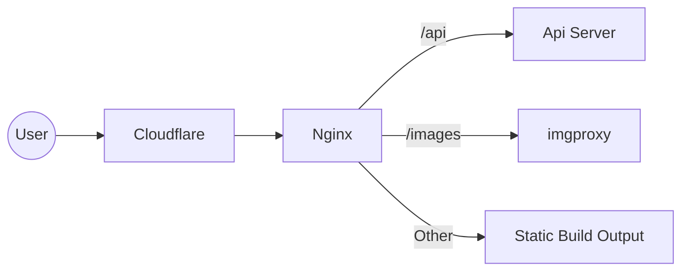
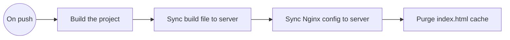

# Comifuro 23 Interactive Map

Unofficial Interactive map for [Comifuro 23](https://comifuro.net). Made because I was bored and want to make something that's interesting with Tanstack Start. The API exists on separate repository [here](https://github.com/RafadanaM/cf23-api).

## Installation

This project uses Bun, oxfmt, and oxlint. To install dependecies, run the following command:

```
bun install
```

## Running The Project

In development, the project uses default tanstack start/vite configuration. However, in production the project will be deployed as a static site which requires Nginx to act as a web server and reverse proxy to the API and imgproxy.

### Development

```
bun run dev
```

### Production

1. Build the project using:

```
bun run build
```

2.  Run Nginx with config pointing to `/deploy/nginx/app.conf`

**Note:**
To test the production version in local you can run the following command to run nginx via docker:

```
docker compose up -d # will run in detached mode
```

note: the local nginx config is available on `/deploy/nginx/local.conf`

## Project Flow

This project sits behind cloudflare as a CDN to cache assets:



Furthermore, this project also features ServiceWorker to cache assets and API result so that the site can be accessed offline and act as a Progressive Web App(PWA)

## Deployment Flow

Github Actions is used to provide automatic deployment on every push


